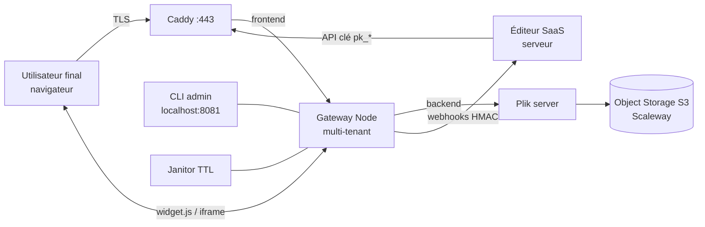

# Plik-SaaS — Large File Transfer as a Service

API multi-tenant de **transfert de gros fichiers** (jusqu'à 200 Go/fichier) à
intégrer chez des éditeurs SaaS. Construite sur [Plik](https://github.com/root-gg/plik) (MIT).

## Pourquoi

Aucune offre grand public ne couvre les transferts > 150 Go. Plutôt qu'un
B2C à l'unité, l'angle retenu est **B2B "API"** : chaque éditeur SaaS
intègre le transfert de fichiers volumineux dans son produit via clé API,
et facture à l'usage.

- **Coût marginal** : ~0,01 €/Go (Hetzner + Scaleway)
- **Revente** : 0,03-0,05 €/Go (marge 66-80 %)
- **TTL courts par défaut** (1 h) : coût stockage quasi nul

## Architecture



La passerelle ajoute à Plik : clés API par éditeur, quotas mensuels,
webhooks signés (uploadé/téléchargé/expiré), widget JS, liens signés.

## Démarrage rapide (une commande)

```bash
curl -fsSL https://raw.githubusercontent.com/PassMortGrim/plik-saas/main/deploy.sh -o deploy.sh \
  && chmod +x deploy.sh \
  && sudo ./deploy.sh --domain plik.exemple.fr --email admin@exemple.fr \
       --scw-key CHANGE_ME --scw-secret CHANGE_ME --scw-bucket plik-saas --scw-region fr-par
```

Le script est idempotent : relançable sans casser une installation saine.

## Étapes

1. `./deploy.sh` installe Docker, compose, Caddy (TLS auto), configure S3 et démarre.
2. Créez votre premier tenant :
   ```bash
   docker compose exec -e ADMIN_TOKEN=$ADMIN_TOKEN gateway node src/admin.js tenant-create "Client Alpha" 500 https://client-alpha.fr/webhook https://app.client-alpha.fr
   ```
3. La clé API s'affiche **une seule fois** : copiez-la immédiatement.
4. Intégrez le widget ou appelez l'API : voir [docs/index.md](docs/index.md).

## Structure du dépôt

```
plik-saas/
├── deploy.sh                 # Installation/déploiement idempotent (bash)
├── docker-compose.yml        # plik + gateway + caddy
├── Caddyfile                 # Reverse proxy TLS
├── .env.example              # Variables (copier en .env)
├── plikd.cfg.template        # Config Plik (S3 Scaleway)
├── gateway/                  # Passerelle multi-tenant (Node 20)
│   ├── Dockerfile
│   ├── src/
│   │   ├── index.js          # Boot + arrêt propre
│   │   ├── config.js         # Configuration validée
│   │   ├── server.js         # API publique + admin (localhost)
│   │   ├── admin.js          # CLI d'administration
│   │   ├── plik.js           # Client REST Plik (streaming)
│   │   ├── store.js          # Persistance atomique (tenants/quota/uploads)
│   │   ├── webhooks.js       # Livraison HMAC + retries + SSRF guard
│   │   ├── janitor.js        # Expirations TTL + événements OneShot
│   │   └── util.js           # Jetons, scrypt, rate limiting, sanitize
│   └── public/
│       ├── widget.js         # SDK navigateur
│       └── widget-page.html  # Page iframe
└── docs/
    ├── index.md              # Documentation API (FR)
    └── openapi.yaml          # Spécification OpenAPI 3.1
```

## Sécurité

Voir [SECURITY.md](SECURITY.md) : modèle de menace, durcissement,
jetons (scrypt + timingSafeEqual), RGPD, playbook incident, checklist production.

Points clés :
- Liens de téléchargement signés impossible à deviner ni forger
- Clés API : hash scrypt, jamais stockées en clair, révocables à chaud
- API admin sur localhost uniquement, token vérifié à temps constant
- Containers non-root, réseaux Docker cloisonnés, ufw + fail2ban

## Coûts

Poste | Coût
---|---
VPS Hetzner (CX32 : 4 vCPU / 8 Go) | ~13 €/mois (option 40 €/mois pour 200 Go disque local)
Object Storage Scaleway | ~2 €/To/mois
Bande passante sortante incluse | 1 To (Hetzner) puis ~1 €/To
**Coût marginal par Go transféré** | **~0,01 €**
**Prix de vente cible** | **0,03-0,05 €/Go** (ou 29-299 €/mois par tenant)

## Statut et limites honnêtes

- **MVP** : code écrit et revu (security review, correctifs intégrés) mais
  **jamais exécuté** dans cet environnement. Testez sur un VPS de staging
  avant tout client payant.
- Les en-têtes/noms de champs de l'API Plik (`X-Upload-Auth`, `X-File-Name`
  en base64, `?stream=true`) et les clés de `plikd.cfg` suivent Plik 1.3.x :
  à valider contre la version exacte déployée lors des tests de staging.
- Store JSON : adapté au lancement ; migration PostgreSQL planifiée.
- Chiffrement côté client : roadmap.

## Licence

MIT, héritée de Plik (root-gg/plik).
